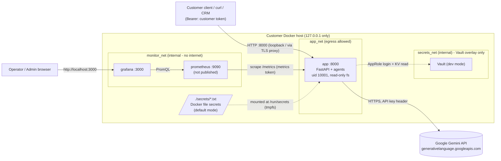

# Deployment Architecture

Customer-controlled, single-host deployment using Docker Compose (Docker Desktop on Windows, or any Linux/macOS Docker host). **Everything runs on infrastructure the customer owns; the only outbound dependency is HTTPS to Google's Gemini API.**

## Architecture diagram

## Components

| Component | Image / tech | Purpose | Exposure |
|---|---|---|---|
| `app` | Built from `Dockerfile` (python:3.12-slim, FastAPI, Uvicorn) | `/health`, `/ready`, `/query`, `/metrics`, `/docs` | `127.0.0.1:8000` |
| `prometheus` | `prom/prometheus:v2.55.1` | Scrapes metrics every 15 s, 15-day retention, alert rules | none (internal network) |
| `grafana` | `grafana/grafana:11.3.0` | Provisioned dashboard "Customer Support API" | `127.0.0.1:3000` |
| `vault` *(optional overlay)* | `hashicorp/vault:1.18` dev mode | Holds Gemini key + customer tokens | none (internal network) |

Application layers: `api.py` (transport, auth, metrics) -> `service.py` (validate, order lookup, classify, route) -> `agents/*` (prompts) -> `llm_client.py` (only module touching the Gemini SDK). `secrets_provider.py` resolves secrets (Vault -> `*_FILE` -> env).

## Network architecture

| Network | Type | Members | Why |
|---|---|---|---|
| `app_net` | bridge (egress) | app | client traffic in, HTTPS to Google out |
| `monitor_net` | **internal** | app, prometheus, grafana | metrics never leave the host; no internet from monitoring containers |
| `grafana_ui` | bridge | grafana | lets Docker publish Grafana to localhost (published ports do not work from internal networks) |
| `secrets_net` | **internal** | app, vault | Vault unreachable from anywhere else |

Published ports are bound to `127.0.0.1`. To serve remote clients, place a TLS-terminating reverse proxy (nginx, Caddy, Traefik, cloud LB) in front; do not change the bind to `0.0.0.0` without TLS.

## Data flow

1. Client sends `POST /query` with `Authorization: Bearer <token>` and `{"query": "..."}`.
2. Middleware assigns a request ID; token is verified in constant time; Pydantic validates the body (1-2000 chars, no extra fields).
3. `service.route_query`: order-status questions are answered locally from demo data (**no Gemini call**); everything else is classified by Gemini (`billing` / `technical` / `general`) and sent to the matching agent, which makes a second Gemini call.
4. Response `{category, answer, request_id}` is returned. Only metadata (category, length, status, latency, request ID) is logged/metered - **never the customer's text or the answer**.
5. Customer text *is* sent to Google as part of the Gemini request (see security-design.md, Data protection).

## Customer ownership

| Asset | Owner |
|---|---|
| Docker host, network, TLS certificates, backups | Customer |
| Gemini API key / Google Cloud project and billing | Customer |
| `secrets/` directory, Vault data, customer API tokens | Customer (admin role) |
| Prometheus / Grafana data volumes | Customer |
| Application source & container image | Delivered by FDE; customer owns the running copy |
| Google's processing of prompts | Google, under the customer's Gemini terms |
